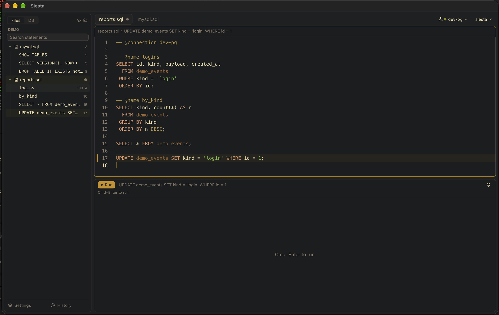

<div align="center">

#  Siesta

**A fast, text-first SQL client for Postgres and MySQL / MariaDB. Queries are plain `.sql` files.**

Write a statement, press <kbd>⌘</kbd> <kbd>Enter</kbd>, read the result. No project files, no cloud, no lock-in.

[](https://www.rust-lang.org)
[](https://www.gpui.rs)
[](#connections)
[](#connections)
[](#install)
[](Cargo.toml)



</div>

---

## Why Siesta

- 📄 **Files are the source of truth.** A `.sql` file holds many statements. It runs unchanged in `psql` and `mysql`, and you can commit, diff and review it like any other code.
- ⚡ **Native and GPU-rendered.** Built in Rust on [GPUI](https://www.gpui.rs), the UI framework behind Zed. One small binary, no Electron.
- 🛡️ **Safe around production.** Mark a connection *production* and every write asks first; mark it *read-only* and writes are refused outright.
- 🧰 **GUI and CLI.** The same files run from the desktop app, a terminal or CI, and the CLI prints JSON for scripts and AI agents.
- 🔐 **No plain-text passwords.** Passwords are encrypted with a local key, never written in clear, and never sent anywhere.

## Features

| | |
|---|---|
| **Editor** | SQL highlighting, completion of tables and columns from the live schema, the statement under the cursor highlighted and run with <kbd>⌘</kbd> <kbd>Enter</kbd>, server errors underlined at their position |
| **Results** | Server-side paging, sorting and column filters on any query; Count all; JSON / JSONB shown as JSON, with a formatted, highlighted preview on hover; a value dialog with search and a JSONPath filter; copy as TSV, JSON or `INSERT` |
| **Connections** | Postgres and MySQL / MariaDB, one JSON file each; a file's `-- @connection` / `-- @database` lines choose them, and the pickers write those lines |
| **Safety** | Production connections get a red banner and confirm every non-read statement; read-only connections refuse writes in Siesta and in the server session; open transactions are asked about before a file or the app closes |
| **Schema** | DB tab: schemas, tables, columns and indexes; insert a `SELECT` for a table or show its DDL |
| **History** | Every run is stored per project (statement, connection, time, duration, rows or error; never the data), whether it came from the app, the CLI (`cli`) or an agent through MCP (`mcp`). A filterable list (<kbd>⌘</kbd> <kbd>Y</kbd>) to insert or rerun any entry. A CLI or MCP statement still executing shows at the top with a spinner (`running`), and the open page follows new runs live |
| **Files** | A central folder of `.sql` files with subfolders, plus files added from anywhere; import, new file / folder, Trash, drag and drop; a statement tree, command palette, light and dark themes, VS Code / JetBrains keymaps, state restored on launch |

## Quick start

```sql
-- @connection dev-pg

-- @name users_by_day
SELECT date_trunc('day', created_at) AS day, count(*)
FROM users
GROUP BY 1
ORDER BY 1 DESC;

UPDATE users SET active = false WHERE last_seen < now() - interval '1 year';
```

Save this as `reports.sql`, open its folder in Siesta, add a connection named `dev-pg` with the **+ Add connection** button, and press <kbd>⌘</kbd> <kbd>Enter</kbd> on either statement. To run it from a terminal instead:

```sh
siesta run reports.sql users_by_day
```

## Install

Siesta currently targets **macOS**. Linux should work but has not been tested yet.

```sh
git clone git@github.com:gandriyko/siesta.git
cd siesta

# Desktop app → target/release/Siesta.app (--install also copies it to /Applications)
scripts/bundle-macos.sh --install

# Or just the binary (GUI + CLI in one)
cargo install --path crates/app
```

You need a recent stable Rust toolchain (edition 2024).

## Desktop app

The sidebar works as in Respite. **COLLECTIONS** is the central folder `~/.config/siesta/collections` with its subfolders: the buttons on its header, and on a folder when you hover it, import `.sql` files (copied in), make a new file or a new folder; the trash button on a file or folder asks, then moves it to the Trash. **FILES** lists `.sql` files from anywhere: `+` (or **File → Add Files…**, <kbd>⌘</kbd> <kbd>O</kbd>) adds several at once, dropping files from Finder on the window does the same, and × takes one off the list (the file stays). `siesta report.sql:12` opens a file at a line and adds it to FILES. Open tabs and cursors come back on the next launch.

| Shortcut | Action |
|---|---|
| <kbd>⌘</kbd> <kbd>Enter</kbd> | Run the statement under the cursor (or the selection) |
| <kbd>⌘</kbd> <kbd>⇧</kbd> <kbd>Enter</kbd> | Run every statement in the file |
| <kbd>⌘</kbd> <kbd>.</kbd> | Cancel the running statement |
| <kbd>⌘</kbd> <kbd>⌥</kbd> <kbd>L</kbd> | Run the last statement again |
| <kbd>⌘</kbd> <kbd>⌥</kbd> <kbd>E</kbd> | Pick the connection |
| <kbd>⌘</kbd> <kbd>Y</kbd> | History |
| <kbd>⌘</kbd> <kbd>P</kbd> / <kbd>⌘</kbd> <kbd>⇧</kbd> <kbd>O</kbd> | Go to file / statement |
| <kbd>⌘</kbd> <kbd>⇧</kbd> <kbd>P</kbd> | Command palette |
| <kbd>⌥</kbd> <kbd>↑</kbd> / <kbd>⌥</kbd> <kbd>↓</kbd> | Previous / next statement |
| <kbd>⌘</kbd> <kbd>J</kbd> | Toggle the result panel |
| <kbd>⌘</kbd> <kbd>⌥</kbd> <kbd>F</kbd> | Column filters |
| <kbd>⌘</kbd> <kbd>[</kbd> / <kbd>⌘</kbd> <kbd>]</kbd> | Previous / next page of results |
| <kbd>⌘</kbd> <kbd>B</kbd> | Toggle sidebar |
| <kbd>⌘</kbd> <kbd>,</kbd> | Settings |

Shortcuts can be changed in `keymap.json` next to `settings.json`.

## Connections

Each connection is one JSON file in `~/.config/siesta/connections/`, named after the connection. The app's connection form writes them, and you can also write them by hand:

```jsonc
// ~/.config/siesta/connections/dev-pg.json
{ "driver": "postgres", "host": "localhost", "port": 5432, "database": "app", "user": "app" }

// ~/.config/siesta/connections/prod-mysql.json
{ "driver": "mysql", "url": "mysql://ro@db.internal:3306/shop", "read_only": true, "prod": true }
```

- **Choosing one.** A file runs on the connection its `-- @connection dev-pg` line names. The top-right dropdown writes that line for you (first line of the file; "No connection" removes it), as an ordinary edit you save or undo, so the choice travels with the file and the CLI sees it.
- **Any database.** `database` is only the default. The second dropdown writes `-- @database app_test` under `-- @connection` ("Default" removes it); picking another connection drops it. The CLI takes `-d app_test`.
- **`"prod": true`.** A red banner, and every statement that is not a plain read (DML, DDL, `SET`, …) asks for confirmation. `SELECT`, `SHOW` and `EXPLAIN` run freely.
- **`"read_only": true`.** Writes are refused before they reach the server, and the session itself is read-only. This is a safety default, not a security boundary.
- **Environment values.** `${env:SHOP_DB_HOST}` is read from the environment, which is handy in CI.

### Passwords

A password is never written in clear. Type it in the connection form, or run `siesta connections set-password NAME`. It is stored as `"password_enc": "v1:…"`, encrypted with XChaCha20-Poly1305 and bound to the connection name. The key is random and lives in `~/.siesta/key` (mode 0600, created on first use), away from the connection files.

- **The key is the secret.** It stays in the data folder, so the connection files can go to a dotfiles repo without it. If it is lost, set the passwords again.
- **What this protects against.** Passwords stay out of screenshots, `grep`, backups and synced files that don't include the key. It does not protect against malware running as your user, which can read the key too.

## Where files live

Two folders, kept apart on purpose: one for what you write, one for what the app writes.

```text
~/.config/siesta/           what you write; fine for a dotfiles repo
  settings.json             settings (the Settings page edits it)
  keymap.json               your key bindings over the defaults (optional)
  collections/              the sidebar's Collections: .sql files, any subfolders
  connections/              one JSON file per connection (passwords only encrypted)
    dev-pg.json             …

~/.siesta/                  what the app writes; holds the password key and the SQL you ran, keep it private
  key                       the key the connection passwords are encrypted with
  files.json                the sidebar's Files: paths of .sql files added from elsewhere
  state.json                open tabs and cursors, reopened on launch
  history/                  every run: <time>.json (source gui / cli / mcp, file, statement, connection, database, outcome)
    running/                CLI / MCP statements executing now, removed when they finish
  cache/                    database structure per connection, for the DB tab and completion
```

- **Collections** are plain files and folders, so Finder, an editor or git work on them too. The trash button moves them to the Trash.
- **Files** stay where they are, for example in a repository; Siesta keeps only their paths. **×** drops one from the list, the file is untouched.
- **A file's connection and database** are its own `-- @connection` / `-- @database` lines: the pickers above the editor write them (an edit you save, or undo), so the choice travels with the file and `siesta run` uses it too. Nothing about them is kept in `~/.siesta`.
- **History** names each file by its full path.
- `SIESTA_CONFIG_DIR` and `SIESTA_DATA_DIR` replace the two folders (tests, sandboxes).

## CLI

The desktop app and the CLI ship as one binary.

```text
siesta list                         Statements of a file or folder: file, line, name, first line
siesta run                          Run statements of a file (all of them, in order, when none are named)
siesta exec                         Run SQL from an argument or stdin
siesta schema                       Tables, columns and indexes; --ddl prints CREATE TABLE
siesta connections                  Connections with secrets masked
siesta connections test NAME        Open a connection to check it
siesta connections set-password NAME
siesta connections databases NAME   Databases the credentials can access
```

Statements are addressed by `-- @name`, `:LINE` or `#N`. Some useful flags:

```sh
siesta run reports.sql users_by_day --output json         # machine-readable (the default when piped)
siesta exec -c dev-pg 'SELECT count(*) FROM users'        # no file needed
siesta exec -c dev-pg -d app_test 'SELECT current_database()'
siesta exec -c prod-mysql --read-only 'SELECT 1'          # writes are refused (exit 4)
siesta run cleanup.sql                                     # on prod, non-read statements ask [y/N] in a terminal
siesta schema -c dev-pg users                             # look at the columns before writing a query
```

- **Output.** `--output` is `table`, `json`, `jsonl` or `csv`. JSON follows the `siesta.run/v1` shape, with JSON / JSONB values nested. Results stop at 100 rows unless you pass `--max-rows`.
- **Exit codes.** `0` ok, `2` connection error, `3` parse error or unknown connection / statement, `4` refused (confirmation needed: pass `--yes`; on a `prod` connection `--yes` is not accepted without a terminal, run it in one and answer the prompt), `5` SQL error.

## AI agents

[`skills/siesta/SKILL.md`](skills/siesta/SKILL.md) teaches a coding agent (Claude Code, Codex and others that read Agent Skills) to explore a schema and run queries through the CLI. Copy the folder into the agent's skills directory, for example `~/.claude/skills/siesta`.

For clients that talk MCP instead of running commands, `siesta mcp` is a stdio MCP server with the tools `connections`, `schema`, `list_statements` and `run_sql`. Each tool runs the CLI command with JSON output, so the results, masking and exit codes are the same. `run_sql` never skips a confirmation: writes on a `read_only` connection and anything that would ask (`-- @confirm`) are refused, and on a `prod` connection it runs only reads and `UPDATE … WHERE` (no `DELETE`, `INSERT`, `DROP`, `TRUNCATE`, `ALTER`). Nothing opens on screen.

```sh
cargo install --path crates/app          # puts `siesta` on PATH
claude mcp add -s user siesta -- siesta mcp
claude mcp get siesta                    # should say Connected
```

`-s user` makes the server available in every project. The tools appear in a new Claude Code session.

## Development

```text
crates/
  app/        GPUI desktop app
  cli/        siesta CLI commands
  sql-split/  statement splitter, directives
  db-conn/    connection files, encrypted passwords
  db-exec/    sqlx sessions, paging, schema, history
  settings/   settings.json
  workspace/  central folder scan, added files, UI state
```

```sh
cargo test --workspace          # unit and GUI tests
scripts/test-db.sh              # integration tests on Postgres and MariaDB in Docker (--down stops them)
```

The principles and decisions behind the design are in [the specification](SPEC.md). Siesta is a sibling of [Respite](https://github.com/gandriyko/respite), a text-first REST client built the same way.

## License

[MIT](Cargo.toml)
