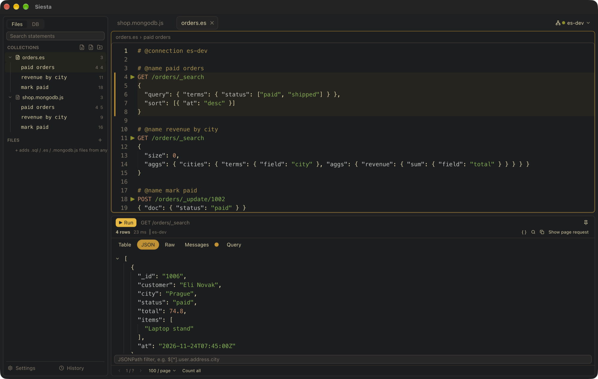

[← Siesta](../README.md)

# Elasticsearch

An `.es` file holds requests in the Kibana Dev Tools console format, so it pastes into Kibana unchanged.



```
# @connection es-dev

# @name adults
GET /users/_search
{ "query": { "range": { "age": { "gte": 18 } } } }

POST /_sql?format=json
{ "query": "SELECT name, age FROM users ORDER BY age DESC" }
```

- A `METHOD /path` line starts a request; the lines after it are its JSON body.
- Comments and directives start with `#` (`# @connection`, `# @name`, `# @confirm`).
- Kibana's `"""…"""` strings work.

## Connection

```jsonc
// ~/.config/siesta/connections/es-dev.json
{ "driver": "elasticsearch", "url": "https://es.internal:9200", "user": "elastic" }
```

- `https://` or any `ssl.mode` but `disable` uses TLS. `require` skips the certificate check.
- `user` with a password is basic auth. A password without `user` is an API key.
- No database, socket, schema or init SQL.

## Results

| Response | Shown as |
|---|---|
| `_search` | Documents: `_id`, then the `_source` fields |
| `_sql` | Its columns and rows |
| `_cat/*` | A table |
| Anything else | One `response` cell with the whole JSON |

- Results open in the **JSON** tab. **Raw** shows the whole response (`hits.total`, `aggregations`, `_shards`). **Table** shows documents in rows.
- A `_search` without its own `size` / `from` pages on the server. The column sort and filters go into the request.
- For aggregations, set `"size": 0`.

## Safety

- `_search`, `GET`, `HEAD` and reading `POST`s (`_count`, `_msearch`, `_sql`, …) are reads. Everything else writes.
- `prod` and `read_only` work as for SQL. `read_only` is checked only in Siesta: Elasticsearch has no read-only session.
- Paths are judged as sent: `/_search/../i/_delete_by_query` is a delete.
- Cancel drops the request; Elasticsearch may still finish it.

## Schema

The DB tab lists indices with their mapping fields. A double click inserts `GET /index/_search`; **DDL** shows `PUT /index` with the mapping.
